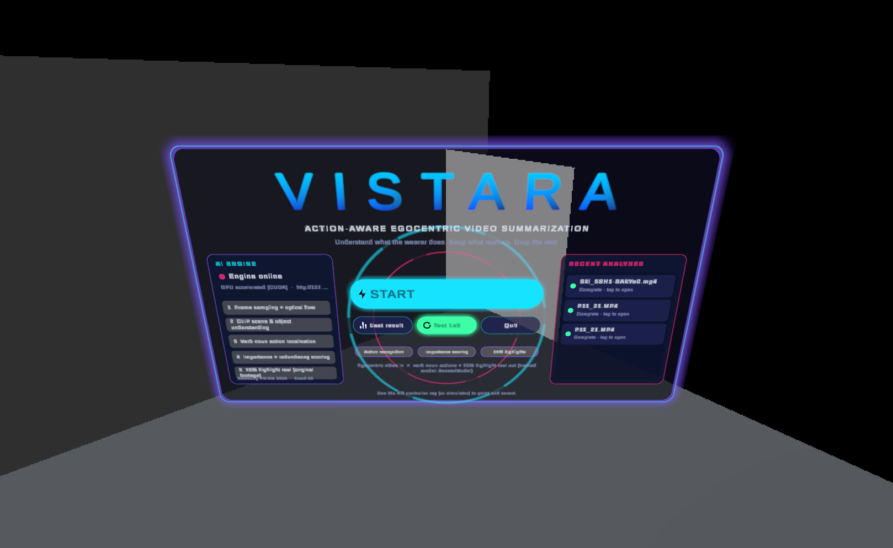
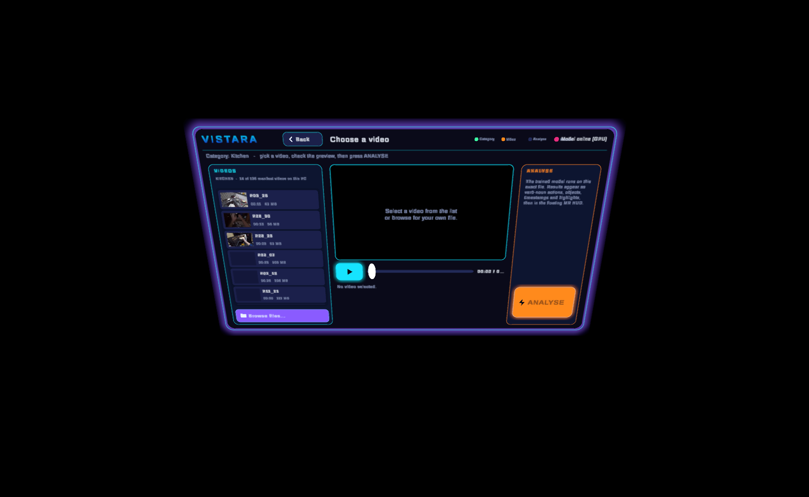
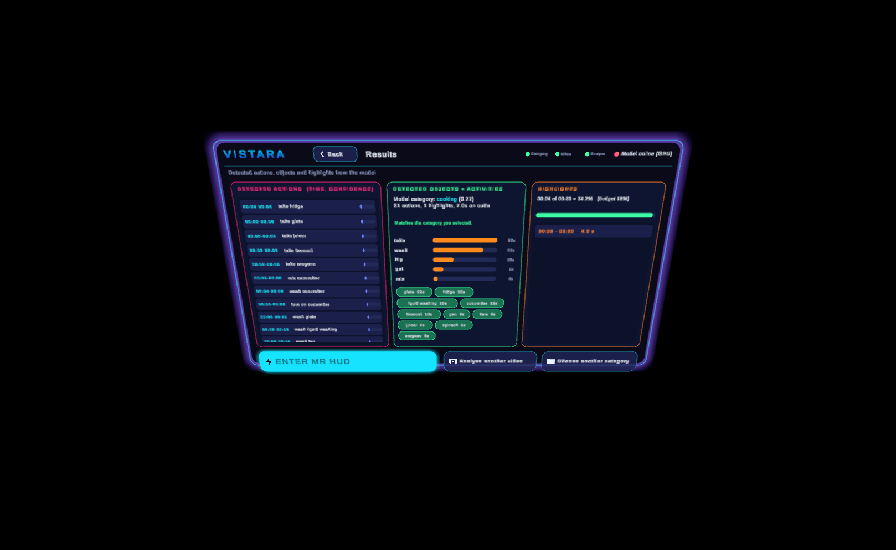
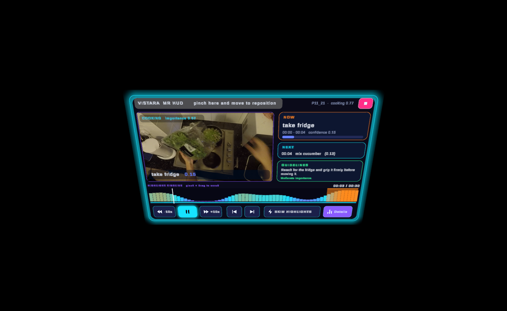
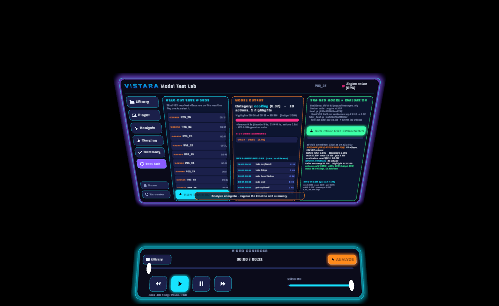

# Vistara

**Action-aware egocentric video summarization in mixed reality** - Samsung R&D Institute India PRISM Hackathon 2026, Track 04.

Vistara watches a first-person video, recognises verb-noun actions, scores how important each moment is and compiles a ~15 % highlight reel from the original footage.
A hand-controlled Unity MR app (Quest 3 / XR Simulator) talks to a local Python engine that runs the trained model.

## Repository layout
```text
vistara/                  <- the competition submission folder (TEAM_ID = vistara)
├── run.sh                #    ./run.sh <video.mp4> <out.json>
├── code/                 #    inference source
├── weights/              #    trained heads (head.pt, label_head.pt) + pretrained CLIP backbone (Git LFS)
├── requirements.txt
├── outputs/              #    59 of the 187 manifest outputs (validated) - see vistara/README.md "Outputs status"
└── README.md             #    setup, architecture, training, reproduction, measured results
unity/VisteraMR/          <- Unity 6 (6000.2.7f2) MR project: hand-controlled flow, Vistara UI, Test Lab, model integration
docs/                     <- demo script / deck outline, screenshots
```
Start with [`vistara/README.md`](vistara/README.md) (model, training, results, how to reproduce) and [`unity/VisteraMR/README.md`](unity/VisteraMR/README.md) (the MR app).

## The trained model
`vistara/weights/head.pt` (verb-noun action head, EPIC-KITCHENS-100 train videos) and `vistara/weights/label_head.pt` (video-category head, FPVSum) on top of a frozen CLIP ViT-B/32.
The same files are used by `run.sh` and by the Unity app (`unity/VisteraMR/Assets/Model/Weights`, byte-identical).
The CLIP backbone (~600 MB) is stored with Git LFS; for the Unity project copy it from `vistara/weights/models--timm--vit_base_patch32_clip_224.openai` to `unity/VisteraMR/Assets/Model/Backbone~/`.

## Measured results (held-out videos, local approximation of the kit metrics)
Action mAP **0.022**, action coverage **0.280**, FPVSum label accuracy **86.7 %**, Highlight F1 **0.180**, 100 % schema-valid, 56/59 within the 15 % budget, ~0.06 x real time on a laptop GPU.
Small samples (14 EPIC + 45 FPVSum videos); action recognition is weak and importance is heuristic. Details and caveats: `vistara/README.md`.

## The MR app (hand-controlled)
START -> 15-category carousel (from `manifest.csv`) -> video selection + preview -> ANALYSE (real model) -> results -> floating MR HUD with live action captions, confidence, timeline, guidance and hand playback.
Tested in the XR Simulator; physical Quest 3 checks (real pinch / swipe / drag) are listed in the Unity README.

| | |
|---|---|
|  **Start** |  **Video selection** |
|  **Results** |  **MR HUD** |
|  **Test Lab** (held-out evaluation) | |

> Screenshots come from the XR Simulator play-mode run. Kitchen frames are from EPIC-KITCHENS-100 (Damen et al., University of Bristol, non-commercial licence).

## Credits
Samsung R&D Institute India PRISM Hackathon 2026 (Track 04 kit); [EPIC-KITCHENS-100](https://epic-kitchens.github.io/2020); FPVSum (Ho et al., ECCV 2018; [azuxmioy/fpvsum](https://github.com/azuxmioy/fpvsum));
CLIP by OpenAI via [OpenCLIP](https://github.com/mlfoundations/open_clip); PyTorch, OpenCV, FFmpeg, FastAPI; Unity 6, XR Interaction Toolkit, XR Hands, OpenXR and the Unity MR template.
Built with [Claude Code](https://claude.com/claude-code) assistance. Please respect the licences of the datasets and of any video you analyse.
