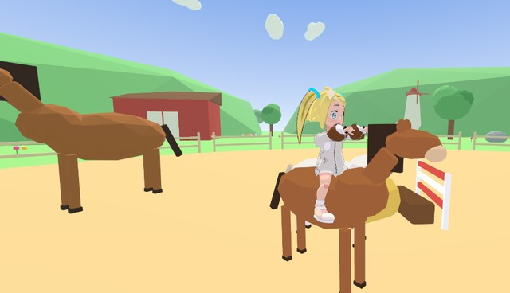
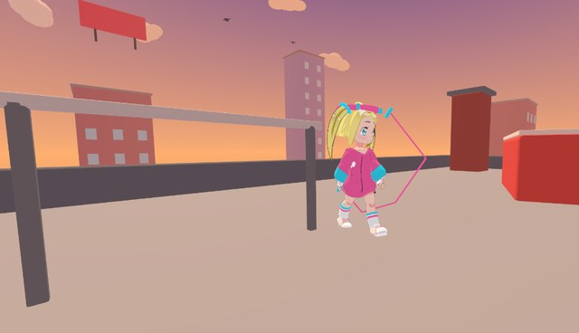
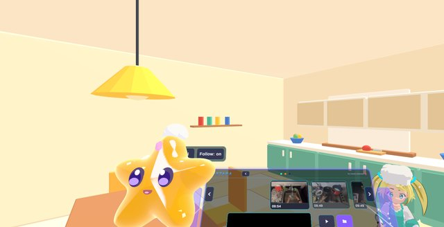
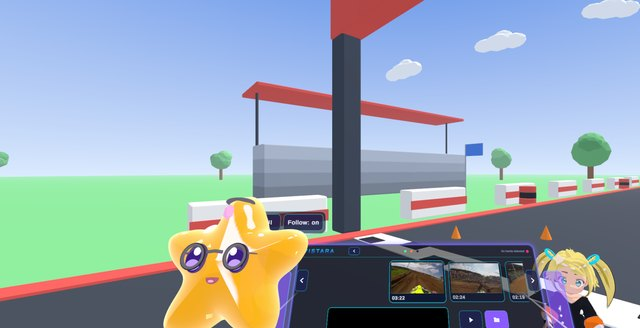
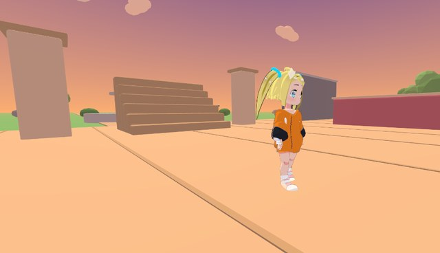
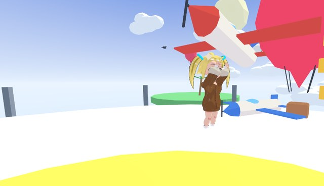
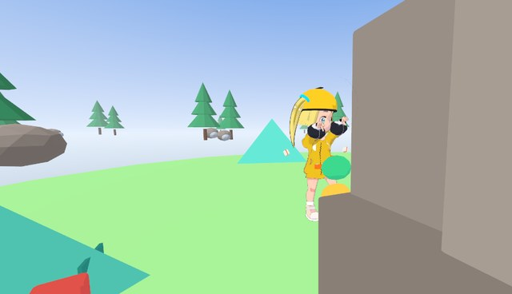
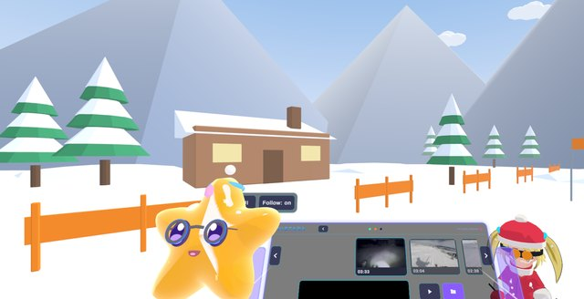
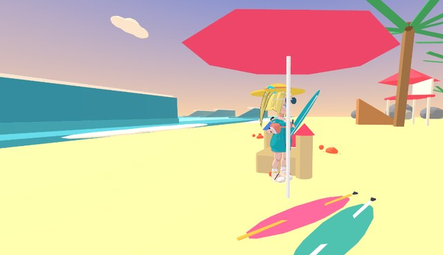

# 🌟 Vistara - Action-Aware Video Summarization (Samsung R&D PRISM 2026, Track 04)

<p align="center"></p>

**What it does:** you give it a first-person video (2-10 minutes). It finds the actions (like "open fridge"), picks the best moments (at most 15 % of the video, each at least 4 s) and writes one JSON file.
A VR app shows the result, and a 3D guide called **Vee** acts out what happens in the video.

`TEAM_ID = vistara`

---

## ▶️ 1. Run the VR app (Windows, easiest)

1. Go to the **[Releases page](https://github.com/emberwing-dash/Vistara/releases)** and download **all 4 zips**:
   - `Vistara-1-App.zip` (the app)
   - `Vistara-2-Model-CLIP.zip` and `Vistara-3-Model-AVION.zip` (the trained model)
   - `Vistara-Sample-Videos.zip` (a few test videos for every category)
2. Extract all 4 into the **same folder** (say "merge" if asked). You get one folder called `Vistara`.
3. Install **Python 3.11 or newer** if you do not have it (tick "Add python.exe to PATH").
4. Double-click **`Vistara\Start Vistara.bat`**.
   - First time: it installs what it needs (a few minutes, internet needed).
   - Then it starts the AI engine (a black window, **keep it open**) and the app.
5. In the app: **START** → pick a category → pick a video → **ANALYSE**.

Own videos: put `.mp4` files into `Vistara\Backend\Videos\<Category>\` (the folders are there). The file name must be one from `code/backend/data/manifest.csv`.

## ▶️ 2. Run the Unity project from this repo

1. `git lfs install` and `git lfs pull` (downloads the model into `weights/`).
2. Double-click **`setup.bat`** once (installs Python packages).
3. **Videos:** download `Vistara-Sample-Videos.zip` from the [Releases page](https://github.com/emberwing-dash/Vistara/releases), open it, and copy the videos into the matching folders in **`videos/`** here (`videos/Bike/`, `videos/Kitchen/`, ...).
4. Open the folder `code/Vistara` in **Unity 6000.2.7f2** (first open takes a few minutes), run **Vistara > Build Scenes** once, press **Play**.

Press Play and the app starts the AI engine by itself (from `code/backend`, using `weights/` and the `.venv` from step 2).
Controls: VR controllers (point + trigger). **Y** hides the panel, **A** shows what Vee sees. Without a headset the XR simulator is used.

## ▶️ 3. Run the model on one video (no VR)

```bash
python -m venv .venv
.venv/Scripts/pip install torch torchvision --index-url https://download.pytorch.org/whl/cu128   # or the CPU wheels
.venv/Scripts/pip install -r requirements.txt
./run.sh <video.mp4> <out.json>
python validate.py --dir outputs/        # expect: 187 files, 0 invalid
```
`outputs/` already holds the 187 result files (one per manifest video). `predictions.jsonl` and `results.csv` contain the same results in one file / one table.

---

## 📁 Where things are
| Folder / file | What |
|---|---|
| `run.sh` | `<video.mp4>` → `<out.json>` (one command, same format for every video) |
| `code/backend/` | the AI engine (Python): `vistara/` model code, `server/` for the app, `validate.py` |
| `code/Vistara/` | the Unity VR project |
| `code/assets/` | Blender files for the 3D worlds, Vee and Stara |
| `weights/` | the trained model (Git LFS) |
| `outputs/` | the 187 JSON results |
| `videos/` | empty folder per category for test videos |
| `cache/` | saved analyses, so videos analysed before open instantly |
| `examples/` | the two example JSONs from the student kit |
| `requirements.txt`, `setup.bat` | Python packages |

## 🧾 Output format
```json
{ "team_id": "vistara", "video_id": "P01_11", "duration_sec": 512.3,
  "label": {"name": "cooking", "score": 0.93},
  "actions":    [{"segment": [12.4, 18.2], "start": 12.4, "end": 18.2, "verb": "open", "noun": "fridge", "score": 0.88}],
  "highlights": [{"segment": [11.0, 19.5], "start": 11.0, "end": 19.5, "importance": 0.93}] }
```

## 🧠 How it works (short)
| Step | Method |
|---|---|
| Label | CLIP ViT-L/14 (frozen), zero-shot over the 16 official labels |
| Actions (kitchen) | **AVION** ViT-L/14 fine-tuned on EPIC-KITCHENS-100 *train* (public MIT checkpoint, converted by `code/backend/training/export_avion.py`) |
| Actions (other videos) | CLIP text similarity + EPIC *train* priors + a small trained head (`head.pt`) |
| Highlights | importance score (motion, change, action confidence), then greedy selection under the 15 % budget |

No video IDs or ground truth are used at inference. AVION is a third-party public checkpoint; we trained the small head, the priors and the label prompts.

**Our own measurements** (`code/backend/evaluation/evaluate_heldout.py`, not the official scorer): kitchen verb accuracy 0.38, noun 0.44, highlight localisation recall 0.95; sports label accuracy 0.92. All 187 outputs pass `validate.py`; 185 come from the full model and 2 are placeholders for two Scuba videos we could not get (listed in `code/backend/outputs_degraded.txt`).

## 👀 Previews
Vee in each of the 15 categories (UI hidden), acting out what the video shows.

| 🚲 Bike | 🏑 Bike Polo | 🥊 Boxing | 🐎 Horse | 🪂 Jumping |
|:---:|:---:|:---:|:---:|:---:|
|  |  |  |  |  |

| 🍳 Cooking | 🛹 Longboarding | 🏍️ Motor | 🤸 Parkour | ✈️ Plane |
|:---:|:---:|:---:|:---:|:---:|
|  |  |  |  |  |

| 🧗 Rock Climbing | 🤿 Scuba | ⛸️ Skate | ⛷️ Ski | 🏄 Surfing |
|:---:|:---:|:---:|:---:|:---:|
|  |  |  |  |  |

Not verified on a physical headset.

## 🤖 AI disclosure
AI tools were used while building this project: **Claude** (Anthropic), **Antigravity** (Google) and **ChatGPT** (OpenAI). They helped with code, the Unity app, the Blender assets and this documentation. The team ran and checked the training, evaluation and outputs.

## 🙏 Credits
Samsung R&D Institute India PRISM Hackathon 2026; [EPIC-KITCHENS-100](https://epic-kitchens.github.io/2020) (University of Bristol, non-commercial licence); FPVSum (Ho et al., ECCV 2018); [AVION](https://github.com/zhaoyue-zephyrus/avion) (MIT); OpenAI CLIP via open_clip / timm.
