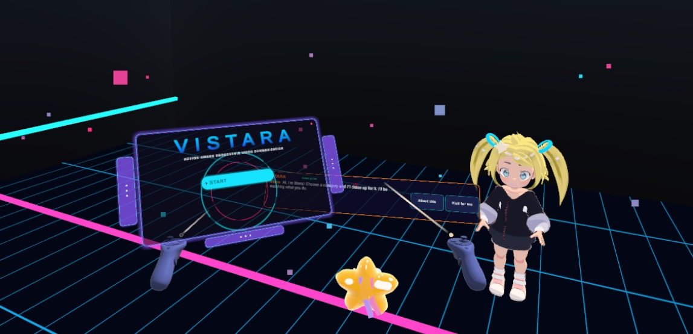
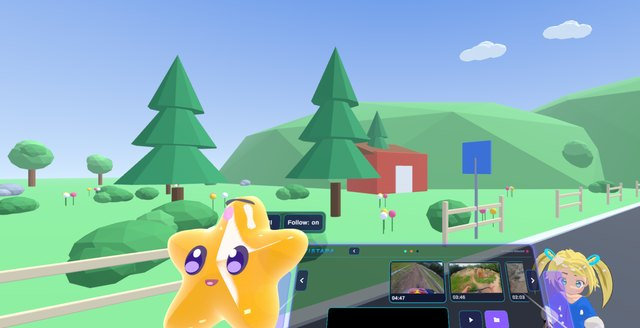
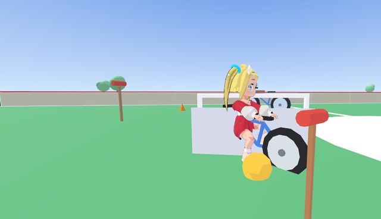
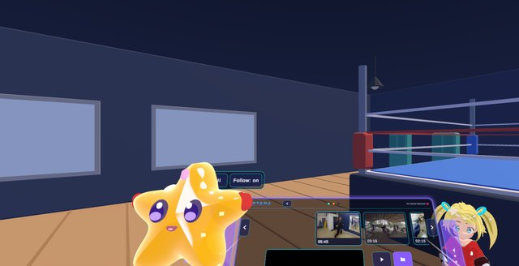
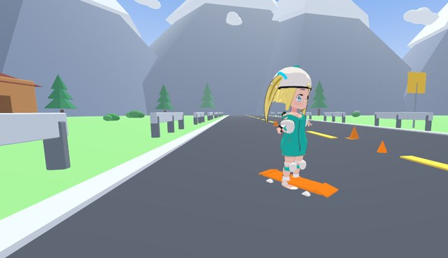
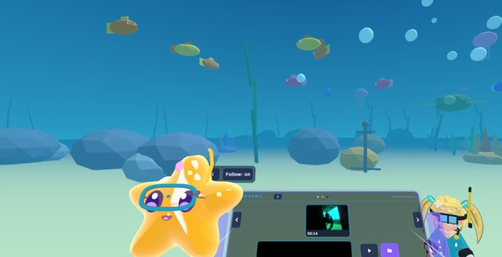
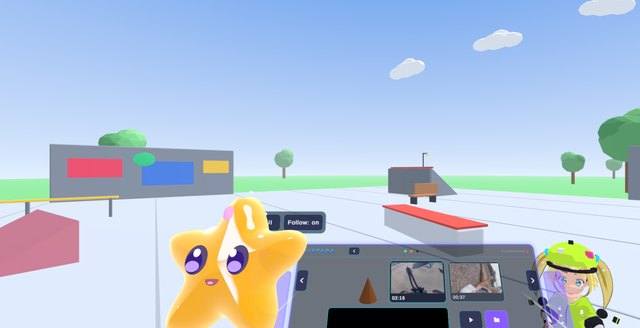

# 🌟 Vistara - Action-Aware Video Summarization (Samsung R&D PRISM 2026, Track 04)

<p align="center"></p>


## 👀 Previews
Meet **Vee** (the guide) and **Stara** (the star mascot, standing on the panel). The start menu opens facing down the neon corridor, and Vee waits in her sci-fi hoodie. Each of the 15 categories has its own world and its own outfit for Vee. Below is Vee in each one, UI hidden, re-enacting an action the video analysis highlights (kitchen: opening the fridge; bike: riding; boxing: hitting the bag ...).

| 🚲 Bike | 🏑 Bike Polo | 🥊 Boxing | 🐎 Horse | 🪂 Jumping |
|:---:|:---:|:---:|:---:|:---:|
|  |  |  |  |  |

| 🍳 Cooking | 🛹 Longboarding | 🏍️ Motor | 🤸 Parkour | ✈️ Plane |
|:---:|:---:|:---:|:---:|:---:|
|  |  |  |  |  |

| 🧗 Rock Climbing | 🤿 Scuba | ⛸️ Skate | ⛷️ Ski | 🏄 Surfing |
|:---:|:---:|:---:|:---:|:---:|
|  |  |  |  |  |

## 🚀 Quick start
`TEAM_ID = vistara`. One run command, one JSON per video, the same format for every video:

```bash
./run.sh <video.mp4> <out.json>
```

Vistara watches a 2-10 minute first-person video, recognises fine-grained verb-noun actions, scores how important each moment is, labels the video,
and selects <= 15 % highlights (each >= 4.0 s) from the original footage. A Unity VR app shows the result and re-enacts it with a 3D guide.

## 🧠 Trained model (where it is)
The model that analyses the videos, both from `./run.sh` and inside the Unity VR app, is in **[`weights/`](weights/)** at the repo root:
[`head.pt`](weights/head.pt) (our trained head), [`pair_prior.npz`](weights/pair_prior.npz), [`avion_vitl_ek100_fp16.pt`](weights/avion_vitl_ek100_fp16.pt) (AVION, Git LFS) and the CLIP ViT-L/14 backbone (Git LFS).
The Unity app does not carry its own copy: when you press Play it starts the engine in `code/backend`, which loads these files. Details in "Weights" below.

## 📁 Repository layout
```text
run.sh                 <video.mp4> -> <out.json>
requirements.txt       Python dependencies
weights/               trained model (see "Weights")
outputs/               one <video_id>.json for each of the 187 manifest videos
predictions.jsonl      the same 187 results, one JSON per line
results.csv            one summary row per video
code/
  backend/             the AI engine (Python)
    vistara/           inference package: decode, features, action recognition (AVION + CLIP head), importance, highlights, JSON schema
    server/            FastAPI server the Unity app talks to (port 8765)
    training/          feature caches, priors, head training, AVION export/eval
    evaluation/        held-out evaluation        tests/   unit + edge tests
    validate.py  make_outputs.py  make_predictions.py  run_manifest.py  data/manifest.csv  data/epic/ (annotations, EPIC downloader)
  Vistara/             Unity 6 (6000.2.7f2) VR project
  assets/              Blender sources (.blend) and exported FBX: category worlds + props, the guide character and her outfits, the star mascot
```

## ⚙️ Setup guide (step by step)
Needs Python 3.11+ (developed on 3.14, Windows 11, RTX 4060 Laptop), about 3 GB of disk for the weights, and Git LFS. A GPU is recommended; the CPU works but is slower.

**1. Get the code and the weights**
```bash
git clone <this repo> && cd <repo>
git lfs install && git lfs pull        # downloads the CLIP backbone (~1.6 GB) and the AVION weights (~590 MB) into weights/
```
**2. Create the Python environment** (Windows paths shown; on Linux/macOS use `.venv/bin/` instead of `.venv/Scripts/`)
```bash
python -m venv .venv
.venv/Scripts/pip install torch torchvision --index-url https://download.pytorch.org/whl/cu128    # GPU; use the CPU wheels if there is no NVIDIA GPU
.venv/Scripts/pip install -r requirements.txt
```
**3. Analyse one video** (fully offline: every weight is read from `weights/`)
```bash
./run.sh video.mp4 out.json
```
`TEAM_ID` (env, default `vistara`) sets `team_id`. ffmpeg comes from PATH or the bundled `imageio-ffmpeg`.

**4. Check the output files**
```bash
python code/backend/validate.py --dir outputs --manifest code/backend/data/manifest.csv     # expect: 187 files, 0 invalid
python code/backend/make_predictions.py                                                       # writes predictions.jsonl + results.csv
```
**5. (Optional) Run the VR app**: see "VR app" below. It starts the engine by itself.

Regenerating all 187 outputs: `python code/backend/make_outputs.py --roots <EPIC dir> <FPVSum dir> --redo` (see "Outputs status").

## 📦 Submission contents
| Item | Where |
|---|---|
| Reproducible inference entry point | `run.sh` (`./run.sh <video.mp4> <out.json>`) + `requirements.txt` |
| Source code | `code/backend/` (engine), `code/Vistara/` (Unity VR app), `code/assets/` (Blender sources) |
| Model weights | `weights/` (Git LFS) |
| Predictions, one JSON per video | `outputs/<video_id>.json` (187), also collected in `predictions.jsonl` |
| Summary table | `results.csv` (label, number of actions and highlights, highlighted seconds and % per video) |
| Validation | `python code/backend/validate.py --dir outputs` (our own validator, written from the track README; the organizers did not provide one) |
| Demo | screen recording of the VR app (add the file / link here before submitting) |

Model size: the weights are not quantized. The AVION ViT-L/14 and CLIP ViT-L/14 backbones are about 2.2 GB in total, so a "< 20 MB INT8" model is not part of this submission.

## 🧾 Output format
```json
{ "team_id": "vistara", "video_id": "P01_11", "duration_sec": 512.3,
  "label": {"name": "cooking", "score": 0.93},
  "actions":    [{"segment": [12.4, 18.2], "start": 12.4, "end": 18.2, "verb": "open", "noun": "fridge", "score": 0.88}],
  "highlights": [{"segment": [11.0, 19.5], "start": 11.0, "end": 19.5, "importance": 0.93}] }
```
`label` is `cooking` for EPIC videos and one of the 14 FPVSum categories (or `other`) otherwise. Highlights are chronological, non-overlapping, each >= 4.0 s,
and within 15 % of the duration (videos shorter than ~27 s keep the >= 4 s rule).

## 🧠 Model
| Stage | Method |
|---|---|
| Decode | 2 fps sampling; Farneback optical flow with dominant-motion subtraction -> hand / object residual motion |
| Label | CLIP ViT-L/14 (OpenAI, frozen), zero-shot prompt ensemble over the 16 official labels |
| Actions (kitchen footage) | **AVION** ViT-L/14 fine-tuned on EPIC-KITCHENS-100 *train* (3806-way verb:noun head; public MIT-licensed checkpoint, converted by `code/backend/training/export_avion.py`), 3 s windows, merged into segments |
| Actions (fallback) | CLIP text similarity + EPIC *train* priors (`pair_prior.npz`) + a trained residual head (`head.pt`) - used for non-EPIC footage or when the AVION weights are absent |
| Importance | activity + temporal change + distinctiveness + action confidence (+ global motion for sport), idle / blur penalties, smoothing |
| Highlights | greedy MMR selection under a hard 15 % budget, >= 4 s segments, temporal spread and pair novelty for kitchen footage |

AVION on 816 held-out segments of 25 EPIC validation videos: verb top-1 75.7 %, noun 64.8 %, action 53.4 % (the CLIP-head fallback: verb ~20 %, noun ~29 %).
Nothing uses video IDs or ground truth at inference; no manifest video was used for training. The AVION weights are a third-party public checkpoint (not trained by us); our own training is the residual head, priors and label prompts (`code/backend/training/`).

## 📊 Measured results (local, 185 videos)
Our own approximation of the metrics, computed against the public ground truth with `code/backend/evaluation/evaluate_heldout.py` (not the official scorer):

| Set | Videos | Result |
|---|---|---|
| EPIC-KITCHENS-100 | 138 | action mAP 0.130, coverage 0.428, verb acc 0.381, noun acc 0.438, verb+noun 0.264, localisation recall (IoU 0.1) 0.945, label `cooking` 100 % |
| FPVSum | 47 | label accuracy 0.915, highlight F1 0.232 |
| All | 185 | schema valid 100 %, within the 15 % budget 98.4 % (mean 14.0 %) |

## 🏋️ Weights (`weights/`)
`head.pt`, `pair_prior.npz` (small, plain git); `avion_vitl_ek100_fp16.pt` (~590 MB) and the CLIP ViT-L/14 backbone (~1.6 GB) are stored with Git LFS (`.gitattributes`).
Regenerate the AVION file from the public checkpoint with `code/backend/training/export_avion.py`.

## ✅ Outputs status
`outputs/` holds 187 valid files (`validate.py`: 0 invalid). **185 are produced by the full model (AVION + CLIP); 2 are placeholders** (label `other`, no actions, evenly spaced 4 s highlights)
for two Scuba videos that could not be obtained; they are listed in `code/backend/outputs_degraded.txt`.
Regenerate with `python code/backend/make_outputs.py --roots <EPIC dir> <FPVSum dir> --redo`.

## 🥽 VR app (`code/Vistara`)
Open the folder in Unity 6000.2.7f2 (run **Vistara > Build Scenes** once), press Play (XR Interaction Simulator or Quest 3). The app starts the engine from `code/backend` with the weights in `weights/`
(Python from `.venv` at the repo root; set `VISTARA_PYTHON` to use another interpreter).

- **Input**: controllers or hands. With controllers, point at a button and pull the **trigger** to press it (also drags carousels and sliders); with hand tracking, touch or pinch.
- **Start menu**: opens facing down the neon corridor; the panel follows you as you walk and turn, and the left controller **Y** button hides or shows it. Vee wears her sci-fi hoodie (open over her play-button shirt, glowing rings on the arms, dark gradient shoes), Stara is on the panel.
- **Start**: the spatial shift (the whole 3D space shifts, chromatic/lens glitch, sound) into the app.
- **Category** (15): another spatial shift loads that category's world (`code/assets/categories/<Category>`); the guide **Vee** changes into the category outfit and says a one-line greeting.
- **Pick a video -> ANALYSE**: the trained model analyses the full test video. Results: the output JSON, the video with the findings marked, and a **storyboard** of real key-moment frames with what happens in each (no charts).
- **Stara** (the star mascot) reads the analysis out in plain words (category, how many actions, the main ones, how much was kept), then leads a tour of the key moments.
- **Re-enactment**: Vee acts out, step by step, the action highlighted in the video with the category's real props (kitchen: opens the fridge and cupboard, takes items out, chops, stirs, washes, turns the stove on; sports: rides the bike / board / horse / skis, boxes the bag, climbs, vaults ...), fingers wrapped around what she holds, with kitchen sounds.
- **Moving around**: walk freely (left thumbstick moves, right thumbstick turns, click the left stick to run; the headset works room-scale) and look at Vee up close. The panels stay attached to your view; the dock at the lower-left of your view has **Hide UI / Show UI** and **Follow on/off** (left controller Y hides, right controller B toggles follow, H in the editor).
- Voice: Vee speaks with the Meta Voice SDK if it is installed, else the headset's text-to-speech (soft voice), else the Windows voice in the editor.

Not verified on a physical headset. Details: `code/Vistara/README.md`.

## 🎨 Assets (`code/assets`)
The 3D content of the VR app, as Blender sources plus the exported FBX files Unity imports:
- **Vee** - the guide character (`character/`): model, textures and one outfit per category.
- **Stara** - the star mascot (`VStar.blend`).
- **Category worlds** (`categories/<Category>/`) - the 15 environments with all their props, each as a `.blend` and as FBX.
- `_build/` - the Blender scripts that generate the worlds and outfits.

## 🙏 Credits
Samsung R&D Institute India PRISM Hackathon 2026; [EPIC-KITCHENS-100](https://epic-kitchens.github.io/2020) (University of Bristol, non-commercial licence); FPVSum (Ho et al., ECCV 2018);
[AVION](https://github.com/zhaoyue-zephyrus/avion) (MIT); OpenAI CLIP via open_clip / timm.

## 🤖 AI disclosure
AI tools were used while building this project:
- **Claude** (Anthropic)
- **Antigravity** (Google)
- **ChatGPT** (OpenAI)

They helped with writing and debugging code, the Unity VR app, the Blender assets and this documentation. The trained components, evaluation and final outputs were run and checked by the team; no ground truth or video IDs are used at inference (see "Model").
